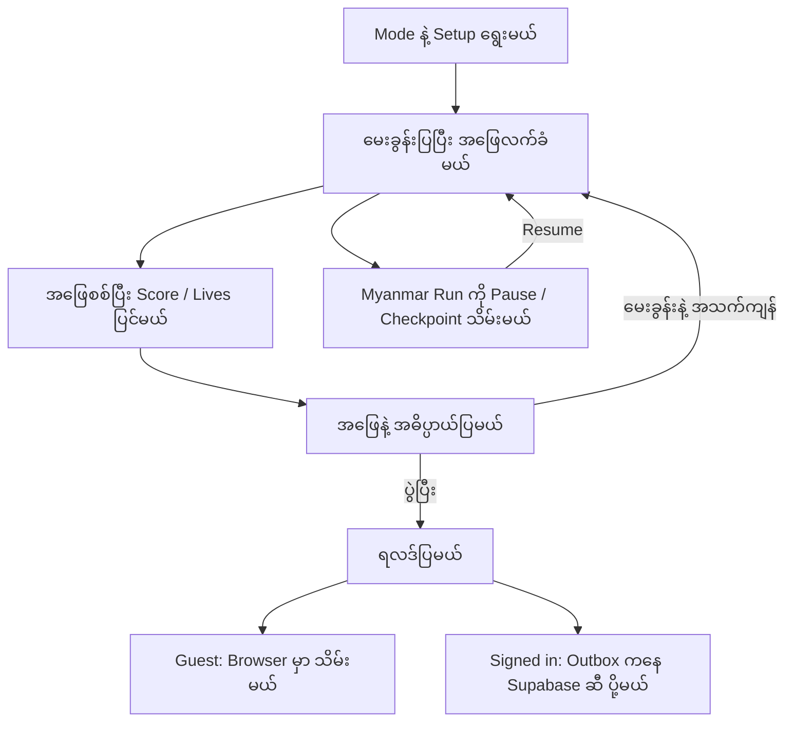

<p align="center"></p>

# Burma Word Quest (စကားလုံး ခန့်မှန်းဂိမ်း)

မြန်မာလို Clue တွေဖတ်ပြီး English စကားလုံးခန့်မှန်းခြင်း၊ မြန်မာဗန်းစကား ရိုက်ဖြေခြင်းနဲ့ စကားပုံဖြည့်ခြင်းတို့ကို ကစားနိုင်တဲ့ React + Vite Project ပါ။ [App ကို ဒီမှာ ဖွင့်နိုင်ပါတယ်](https://burma-word-quest.vercel.app/)။

[Burma Project Ideas](https://github.com/burma-project-ideas) အောက်မှာ နောက်လာမယ့်သူတွေ လေ့လာနိုင်ဖို့၊ ကိုယ်နှစ်သက်တဲ့ Programming Language နဲ့ ပြန်ရေးကြည့်နိုင်ဖို့ ထားပေးထားတာပါ။ Guest အဖြစ် Account မလိုဘဲ ကစားနိုင်ပြီး Online Account၊ Leaderboard နဲ့ Player Profile အတွက် Supabase ကို အသုံးပြုထားပါတယ်။

## အဓိက ပံ့ပိုးသူများနှင့် မူရင်း Data

| ပံ့ပိုးသူ / ရင်းမြစ် | ပံ့ပိုးထားသည့်အပိုင်း |
| --- | --- |
| [Sai Wanna Tun — @SaiWunnaTun-KP၊ ယခင် Jeff307-kib](https://github.com/SaiWunnaTun-KP/End-Game) | မူရင်း **Assembly: End-Game** ကို ဖန်တီးသူ၊ ဒီ Project ရဲ့ မူရင်း Game နဲ့ Inspiration |
| [Sann Lynn Htun — @sannlynnhtun-coding](https://github.com/sannlynnhtun-coding) | Myanmar Modes၊ Clues၊ Category/Difficulty၊ Mobile UI၊ Account/Leaderboard၊ Feedback၊ PWA နဲ့ Burma Word Quest အဖြစ် ပြင်ဆင်ရေးသားမှု |
| [Ban Sagar (ဗန်းစကား)](https://bansagar.com/) | မြန်မာဗန်းစကား ရင်းမြစ်၊ Game အတွက် Clue များကို ပြန်ရေးထားပါတယ် |
| ဆရာ ဒေါက်တာ ဝင်းသိန်း၏ Website | မြန်မာစကားပုံ ရင်းမြစ်၊ ဆက်စပ် [Myanmar Proverbs Source Credits](https://github.com/burma-project-ideas/myanmar-proverbs#readme) ကိုလည်း ကြည့်နိုင်ပါတယ် |
| Noto Sans Myanmar | Mobile မှာ အသုံးပြုထားတဲ့ Font၊ [SIL Open Font License](public/fonts/noto-sans-myanmar-OFL.txt) ပါဝင်ပါတယ် |

မူရင်း Git History နဲ့ Fork Relationship ကို ထိန်းထားပါတယ်။ Repository နဲ့ Upstream မှာ Project တစ်ခုလုံးအတွက် License ကို မတွေ့ရသေးပါဘူး။ ပါဝင်ပြီးသား YoeShin နဲ့ Octagon Fonts အတွက် Redistribution Notice ကိုလည်း ဒီ Checkout မှာ မတွေ့ရသေးပါဘူး။ Data၊ Font နဲ့ Code ကို ပြန်ယူသုံးမယ်ဆိုရင် သက်ဆိုင်ရာ Source Terms ကို အရင်စစ်ပါ။ Credit ပေးထားတာက ပြန်လည်ဖြန့်ဝေခွင့်ရရှိထားကြောင်း အာမခံတာ မဟုတ်ပါဘူး။

## အသုံးပြုပုံ

1. Home မှာ **English Words**၊ **Myanmar Slang** သို့မဟုတ် **မြန်မာစကားပုံ** ကို ရွေးပါ။
2. English အတွက် Category နဲ့ Difficulty ရွေးပါ။ စကားပုံအတွက် ရွေးဖြေခြင်း သို့မဟုတ် ရိုက်ဖြေခြင်းကို ရွေးပါ။
3. စည်းမျဉ်းတွေ ဖတ်ပြီး **စကစားမယ်** ကို နှိပ်ပါ။ စာလုံးရွေးခြင်း၊ အဖြေရိုက်ခြင်း သို့မဟုတ် အဖြေတစ်ခုရွေးခြင်းနဲ့ ကစားပါ။
4. အဖြေနဲ့ အဓိပ္ပာယ်ကို ဖတ်ပြီး နောက်မေးခွန်းကို ဆက်ပါ။ Myanmar Challenge ကို Pause လုပ်ပြီး ဒီ Browser မှာ ပြန်ဆက်နိုင်ပါတယ်။

| Mode | Input | စည်းမျဉ်းနှင့် ရလဒ် |
| --- | --- | --- |
| English Words | On-screen Keyboard သို့မဟုတ် Physical Keyboard နဲ့ အက္ခရာခန့်မှန်းမယ် | စကားလုံး ၂၄၀၊ Category ၄ မျိုး၊ Difficulty ၃ ဆင့်။ တစ်ပွဲမှာ မှားခွင့် ၈ ကြိမ်နဲ့ Letter Hint အခမဲ့ တစ်ကြိမ်ပါပြီး Win နဲ့ Streak ကို သိမ်းပါတယ် |
| Myanmar Slang | အဓိပ္ပာယ်ကိုဖတ်ပြီး မြန်မာဗန်းစကား ရိုက်မယ် | မေးခွန်း ၂၀ ကို မထပ်အောင် Shuffle လုပ်ထားတဲ့ ပွဲရှည်၊ ပွဲတစ်ပွဲလုံးအတွက် အသက် ၃ ခု |
| စကားပုံ — ရွေးဖြေ | ပထမတစ်ဝက်ကိုကြည့်ပြီး ကျန်တစ်ဝက်ကို ရွေးမယ် | ကစားနိုင်တဲ့ စကားပုံ ၈၆၉ ခုနဲ့ အသက် ၃ ခု |
| စကားပုံ — ရိုက်ဖြေ | ကျန်တစ်ဝက်ကို Myanmar Keyboard နဲ့ ရိုက်မယ် | စကားပုံ Data တူပေမယ့် Run နဲ့ Leaderboard ကို ရွေးဖြေ Mode နဲ့ သီးခြားထားပါတယ် |

Interface က Myanmar ကို Default ထားပြီး EN/MM ရွေးချယ်မှုကို မှတ်ထားပါတယ်။ ဘာသာပြန်မှုက အပြည့်အစုံ မဟုတ်ပါဘူး။ Clues၊ ရှင်းလင်းချက်နဲ့ Controls အချို့က မြန်မာလိုပဲ ရှိပါတယ်။ Home မှာ `1`၊ `2`၊ `3` နဲ့ Mode ရွေးနိုင်ပြီး Tab/Enter နဲ့လည်း အသုံးပြုနိုင်ပါတယ်။ `?` Help Dialog မှာ Keyboard Shortcuts ကို ကြည့်ပါ။

## App ရဲ့ Workflow

### ၁။ Game Data နဲ့ သိမ်းထားတဲ့ State ကို ဖတ်မယ်

[src/App.jsx](src/App.jsx) က Game Mode၊ Setup နဲ့ Navigation ကို ချိတ်ဆက်ပေးပါတယ်။ English Data ကို `src/gameData.js`၊ Slang ကို `src/slangData.js`၊ စကားပုံကို `src/proverbs.json` ကနေ ဖတ်ပါတယ်။ `src/proverbData.js` နဲ့ `src/proverbSplit.js` က စကားပုံကို အစတစ်ဝက်နဲ့ အဖြေတစ်ဝက် ခွဲပြီး ကစားနိုင်တဲ့ Entry တွေ ပြင်ဆင်ပေးပါတယ်။

Browser ထဲက Language၊ Stats နဲ့ Checkpoint တွေကို ပြန်ဖတ်ပါတယ်။ မူရင်း `assembly-*` Storage Keys နဲ့ PWA App ID `/` ကို ဆက်သုံးထားတာကြောင့် Origin တူနေသရွေ့ Rebrand ကြောင့် State မပျောက်ပါဘူး။

### ၂။ မေးခွန်းကို ရွေးပြီး အဖြေစစ်မယ်

English မှာ ရွေးထားတဲ့ Category/Difficulty အလိုက် Pool ထဲက စကားလုံးယူပြီး Pool တစ်ပတ်ကုန်အောင် မထပ်စေပါဘူး။ ခန့်မှန်းတဲ့ အက္ခရာ ပါ/မပါအလိုက် စာလုံးဖော်ပေးခြင်းနဲ့ မှားခွင့်လျော့ခြင်းကို လုပ်ပါတယ်။

Myanmar Modes ကို [MyanmarChallenge.jsx](src/components/MyanmarChallenge.jsx) က ပြပါတယ်။ [createChallenge()](src/challenge.js) က မေးခွန်း ID တွေကို မထပ်အောင် Shuffle လုပ်ပြီး Run UUID၊ Lives နဲ့ Counters တွေ ပြင်ဆင်ပါတယ်။ အဖြေမှန်ရင် Correct တိုးပြီး အသက်မလျော့ပါဘူး။ မှားဖြေခြင်းနဲ့ Skip တစ်ကြိမ်စီမှာ အသက်တစ်ခုလျော့ပြီး အဖြေကို ပြပါတယ်။ Deck ကုန်ခြင်း၊ အသက်ကုန်ခြင်း သို့မဟုတ် Stop လုပ်ခြင်းမှာ Run ပြီးဆုံးပါတယ်။

### ၃။ ဖြေချိန်နဲ့ Pause/Resume ကို သိမ်းမယ်

Myanmar Challenge မှာ မေးခွန်းဖြေနေချိန်ကိုပဲ စုပါတယ်။ အဖြေဖတ်ချိန်၊ Pause၊ Background Tab နဲ့ Account Dialog ဖွင့်ထားချိန်တွေကို ဖယ်ထားပါတယ်။ English Round Timer က Wall-clock အချိန်ဖြစ်ပြီး အခြား Panel သို့မဟုတ် Background မှာ နေတဲ့အချိန်လည်း ပါပါတယ်။

Checkpoint ကို Browser ထဲမှာ သိမ်းပြီး `restoreChallenge()` က Dataset၊ Player Identity၊ Counter နဲ့ Phase ကို စစ်ပါတယ်။ ဖြေနေတုန်း Reload လုပ်ထားတဲ့ Run ကို ပြန်ဖွင့်ရင် Paused State နဲ့ စပါတယ်။ Home က Resume Button နဲ့ ဆက်ကစားနိုင်ပါတယ်။

### ၄။ ရလဒ်ကို Local သို့မဟုတ် Online သိမ်းမယ်

Guest အဖြစ်ကစားရင် Local State ပဲ သိမ်းပါတယ်။ Account ဝင်ထားရင် `src/useGameAccount.js` က Result ကို UUID နဲ့ Retry Outbox ထဲ ထည့်ပြီး Supabase RPC ဆီ ပို့ပါတယ်။ Myanmar Run ရဲ့ Player Identity ကို Run စတဲ့အချိန်မှာ သတ်မှတ်ထားပြီး Guest History ဟောင်းတွေကို အလိုအလျောက် Upload မလုပ်ပါဘူး။

Paused Challenge Snapshot ကိုလည်း ပို့နိုင်ပြီး Final Result ကို ပြန်ပြင်ခွင့် မပေးပါဘူး။ `src/challengeOutbox.js` က Run တူတဲ့ Snapshot အသစ်ကို အစားထိုးကာ Retry အဟောင်းကြောင့် ရလဒ်အသစ် မပျောက်အောင် စစ်ပေးပါတယ်။ Challenge Ranking က Correct အများဆုံး၊ ပြီးမှ Active Time အနည်းဆုံးအလိုက် စီပါတယ်။ English Ranking က Wins၊ ပျမ်းမျှအနိုင်ရချိန်နဲ့ Best Streak ကို သုံးပါတယ်။



### ၅။ Leaderboard နဲ့ Player Profile ပြမယ်

`/leaderboard` မှာ Mode အလိုက် Ranking ကြည့်နိုင်ပါတယ်။ `/players/<player UUID>` မှာ Share လုပ်နိုင်တဲ့ Public Profile နဲ့ ၃၆၅ ရက်စာ Correct-answer Activity Chart ပါပါတယ်။ နေ့အလိုက် စာရင်းကို Myanmar Time နဲ့ ခွဲထားပြီး Public RPC က Player ID၊ Display Name နဲ့ Aggregate Activity ပဲ ပြန်ပေးပါတယ်။ Email နဲ့ Authentication Metadata ကို မပြပါဘူး။ Feedback က Account ဝင်ထားသူအတွက်ဖြစ်ပြီး Myanmar Calendar Day တစ်ရက်မှာ တစ်ကြိမ်ပဲ ပို့နိုင်ပါတယ်။

## Data ကို လေ့လာချင်ရင်

[src/gameData.js](src/gameData.js) မှာ English Answer၊ Burmese Clue နဲ့ Meaning တွေ၊ [src/slangData.js](src/slangData.js) မှာ Slang နဲ့ Alias/Normalization Logic တွေ ရှိပါတယ်။ [src/proverbs.json](src/proverbs.json) က မူရင်းစကားပုံ Data ဖြစ်ပြီး [src/proverbData.js](src/proverbData.js) က App အတွက် Playable Entries ပြင်ပေးပါတယ်။ UTF-8 နဲ့ ဖတ်ပါ။

စလေ့လာမယ်ဆိုရင် မေးခွန်းတစ်ခုနဲ့ အဖြေစစ်တဲ့ Form ကို အရင်ရေးကြည့်ပါ။ ပြီးမှ Shuffle၊ Lives၊ Timer နဲ့ Checkpoint ကို ဆက်ရေးနိုင်ပါတယ်။ Dataset အရေအတွက် ပြောင်းရင် Supabase RPC ရဲ့ Total Validation ကိုလည်း တစ်ပါတည်း ပြင်ရပါမယ်။ Data ပြန်ယူသုံးခွင့်ကို မူရင်း Source Terms နဲ့ စစ်ပါ။

## Project ဖွဲ့စည်းပုံ

| နေရာ | တာဝန် |
| --- | --- |
| `src/App.jsx` | Navigation၊ English Game၊ Setup နဲ့ Account Panels |
| `src/components/` | Myanmar Challenge၊ Dialog၊ Leaderboard၊ Profile နဲ့ Feedback UI |
| `src/challenge.js`၊ `src/challengeOutbox.js` | Run State၊ Checkpoint Validation နဲ့ Snapshot Retry |
| `src/gameData.js`၊ `src/slangData.js`၊ `src/proverbs.json` | English၊ Slang နဲ့ စကားပုံ Data |
| `src/useGameAccount.js`၊ `src/supabase.js` | Auth၊ Online Result Queue နဲ့ Supabase Client |
| `src/index.css`၊ `src/mobile.css`၊ `src/theme.css` | Layout၊ Mobile နဲ့ Navy/Mint Styling |
| `public/` | Font၊ Brand Artwork၊ Icons၊ Legal Pages နဲ့ Social Preview |
| `scripts/` | Regression Tests နဲ့ PWA Artwork Generator |
| `supabase/` | Database Migrations၊ SQL Tests နဲ့ Provider Setup |
| `vite.config.js`၊ `vercel.json` | Build/PWA၊ Direct Routes နဲ့ Security Headers |

## Local မှာ Run မယ်

**Node.js LTS** နဲ့ **npm** လိုပါတယ်။ Verification မှာ Node.js 24 ကို သုံးထားပါတယ်။

```sh
npm ci
npm run dev
```

Terminal မှာ ပြတဲ့ Local URL ကို ဖွင့်ပါ။ ကိုယ်ပိုင် Supabase Backend သုံးချင်ရင် Git ထဲမတင်တဲ့ `.env.local` ဖိုင်မှာ ဒီလိုထည့်ပါ။

```dotenv
VITE_SUPABASE_URL=https://your-project.supabase.co
VITE_SUPABASE_PUBLISHABLE_KEY=your-publishable-key
```

လက်ရှိ Source မှာ ရှိပြီးသား Supabase URL နဲ့ Browser-safe Publishable Key ကို Default ထားပါတယ်။ Service-role Key၊ Database Password နဲ့ OAuth Secret ကို `VITE_` Variables ထဲ မထည့်ပါနဲ့။ Backend Host ပြောင်းရင် `vercel.json` ရဲ့ CSP `connect-src` ကိုလည်း ပြင်ပါ။

[Supabase Setup](supabase/README.md) နဲ့ [Google Setup](supabase/GOOGLE_SETUP.md) ကို ဖတ်ပါ။ Database အသစ်အတွက် `supabase/migrations/` ထဲက `202610140001_game_leaderboard.sql` မှ `202610170008_legacy_result_execute_permissions.sql` အထိ Filename အစဉ်လိုက် Review လုပ်ပြီး Apply လုပ်ရပါမယ်။ ရှိပြီးသား Production Database ကို Reset မလုပ်ပါနဲ့။

App မှာ Nickname-only Anonymous Account၊ Email/Password နဲ့ Google Sign-in Flow တွေ ပါပေမယ့် Provider Settings အပေါ် မူတည်ပါတယ်။ ယခင် Setup Notes မှာ Google ကို ဖွင့်ထားပြီး Anonymous Sign-ins နဲ့ Manual Identity Linking ကို ပိတ်ထားကြောင်း မှတ်တမ်းရှိပါတယ်။ လက်ရှိ Dashboard State ကို အတည်မပြုရသေးပါဘူး။

## Build နဲ့ Deployment

```sh
node --test scripts/*.test.mjs
npm run lint
npm run build
npm run preview
```

Production Output က `dist/` ဖြစ်ပြီး PWA Manifest နဲ့ Service Worker ကို Build မှာ Generate လုပ်ပါတယ်။ Offline စမ်းမယ်ဆိုရင် Production Build ကို ပထမဆုံး Online ဖွင့်ပြီး Service Worker Cache ပြည့်အောင် စောင့်ပါ။ Auth၊ Ranking၊ Feedback နဲ့ Cloud Save က Network လိုပါတယ်။

Vercel မှာ Repository [burma-word-quest](https://github.com/burma-project-ideas/burma-word-quest) ကို ချိတ်ပြီး Build Command `npm run build`၊ Output Directory `dist` သတ်မှတ်ပါ။ `vercel.json` မှာ `/leaderboard`၊ `/about` နဲ့ `/players/:id` အတွက် SPA Rewrites နဲ့ Security Headers ပါပါတယ်။ အခြား Host မှာလည်း အဲ့ဒီ Routes ကို `index.html` ဆီ ပြန်ပို့ပြီး Static Assets၊ `/privacy.html` နဲ့ `/terms.html` ကို သီးခြား Serve လုပ်ပေးရပါမယ်။ Deployed PWA အတွက် HTTPS လိုပါတယ်။

Public App က [burma-word-quest.vercel.app](https://burma-word-quest.vercel.app/) ပါ။ ယခင် `swnt-end-game.vercel.app` က Path နဲ့ Query String ကို ထိန်းပြီး **308 Permanent Redirect** လုပ်ထားပါတယ်။ Domain ပြောင်းတာနဲ့ Local Progress သို့မဟုတ် Session တွေ အလိုအလျောက် မရွှေ့ပါဘူး။ Supabase Site URL/Redirect Allowlist နဲ့ Google OAuth Origins/Branding မှာ Domain အသစ်ကို ထည့်ဖို့လိုပြီး အဲ့ဒီ Provider Dashboard Settings တွေကို Domain Update မှာ မပြင်ထားပါဘူး။

Brand Artwork ပြင်ရင် `npm run generate:pwa-icons` နဲ့ Logo၊ Install Icons နဲ့ Social Preview ကို ပြန်ထုတ်ပါ။ `index.html` ရဲ့ JSON-LD ပြင်ရင် `vercel.json` ထဲက SHA-256 CSP Hash ကိုလည်း ပြင်ပါ။ Security-header Test က Hash ကို စစ်ပေးပါတယ်။ `supabase/tests/` က SQL Checks တွေက Configured Database လိုပြီး Fixture/Rollback Behavior ကို အရင်ဖတ်ပါ။

## လက်ရှိ ကန့်သတ်ချက်များ

- Leaderboard က Client-reported Result ကို သုံးထားတဲ့ Casual Ranking ဖြစ်လို့ ဆုကြေးပေးတဲ့ပြိုင်ပွဲ သို့မဟုတ် ယုံကြည်စိတ်ချရတဲ့ Competitive Ranking အတွက် မသုံးသင့်ပါဘူး။
- ၂၀၂၆ နိုဝင်ဘာ ၇ ရက် စစ်ဆေးစဉ်မှာ Configured Supabase Hostname က Test Environment မှာ DNS Resolve မရဘဲ Live Leaderboard က Connection Error ပြခဲ့ပါတယ်။ Sign-in၊ Cloud Writes နဲ့ Production SQL Permissions ကို အတည်မပြုရသေးပါဘူး။
- Browser Data ရှင်းခြင်း၊ Device/Browser သို့မဟုတ် Domain ပြောင်းခြင်းကြောင့် Local Checkpoint၊ Guest History နဲ့ မပို့ရသေးတဲ့ Result တွေကို ပြန်မရနိုင်ပါဘူး။
- EN/MM ဘာသာပြန်မှု မပြည့်စုံသေးသလို မူရင်း Clue နဲ့ စကားပုံ Data တွေမှာ Editorial Correction လိုနိုင်ပါတယ်။
- Vite Build မှာ Large Chunk Warning ရှိပြီး ယခင် Dependency Install က Audit Finding ၉ ခု — Low ၃ ခု၊ Moderate ၆ ခု — ပြထားပါတယ်။ ဒီ Documentation Update မှာ Dependency Upgrade မလုပ်ထားပါဘူး။
- မူရင်း Code၊ Data နဲ့ Fonts အချို့ရဲ့ Redistribution Terms ကို အပြည့်အစုံ မသတ်မှတ်နိုင်သေးပါဘူး။ အထက်က Source Credits နဲ့ ပါဝင်ပြီးသား License ကို စစ်ပြီးမှ ပြန်ယူသုံးပါ။

## UI Design နဲ့ ပါဝင်ပံ့ပိုးခြင်း

Navy Background၊ Mint Actions နဲ့ စကားလုံးဂိမ်းအတွက် Speech-tile Logo ကို သုံးထားပါတယ်။ Existing React Components နဲ့ Radix Icons ကို ဆက်သုံးပြီး App အတွက် CSS ရေးထားတာပါ။ ပြင်ပ UI Template ကို ထည့်ထားတာ မဟုတ်ပါဘူး။ Mobile Layout၊ Keyboard Focus၊ Dialog နဲ့ Reduced Motion ကို ပံ့ပိုးထားပြီး လက်ရှိ Theme က Dark တစ်မျိုးတည်းပါ။

ပြင်ဆင်မယ်ဆိုရင် သက်ဆိုင်ရာ `AGENTS.md` ရှိ/မရှိ အရင်စစ်ပါ။ Data Test တွေအပြင် Correct/Wrong Answer၊ Skip၊ Lives ကုန်ခြင်း၊ Pause/Resume၊ Reload Recovery နဲ့ Pending Result Retry ကို စမ်းပါ။ Desktop/Mobile၊ Myanmar Font၊ Keyboard နဲ့ Offline Behavior ကိုလည်း စစ်ပါ။ Build အောင်မြင်တာတစ်ခုတည်းက Backend နဲ့ Real-device Test ကို အစားမထိုးနိုင်ပါဘူး။
